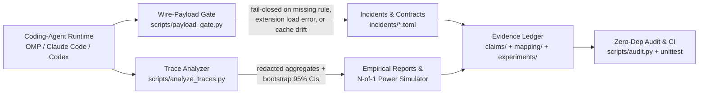

# Akribeia

**Every harness knob carries its proof.**

*Akribeia* (Ancient Greek ἀκρίβεια: *exactness, rigorous verification*; sister project to [Aletheia](https://github.com/iridyne/aletheia)) is a zero-dependency research and verification toolkit for **agent harness engineering** in heavy, long-horizon coding workflows. *(Formerly prototyped as Proof-Carrying Harness / PCH.)*

Agent quality is not model quality alone; it is `model × harness` — the execution loop, tool interface, context policy, memory rules, and deterministic controls wrapping the model. Yet most harnesses ship as prompt folklore: piles of rules and flags whose authors cannot prove which rules actually reached the model wire payload, whether a change beat autocorrelation noise, or which paper/incident justified each line.

**Akribeia turns harness engineering from folklore into falsifiable systems science:**

1. **Evidence-Gated Ledger (`scripts/audit.py`, `scripts/report.py`)** — every harness intervention maps to a typed claim (`literature`, `hypothesis`, or `decision`), every hypothesis names a falsifier and stop rule, and secret/path hygiene is enforced fail-closed in CI.
2. **Provider-Agnostic Wire-Payload Contract Gate (`scripts/payload_gate.py`)** — verifies serialized request payloads across **Anthropic Messages API**, **OpenAI Chat / Responses API**, and **OMP**; detects silent **Prompt Cache** system-prefix SHA-256 drift; and **mechanically rejects vacuous negative-only assertions** unless paired with a positive witness (`INC-0006`).
3. **Privacy-Safe Heavy-Coding Trace Telemetry (`scripts/analyze_traces.py`)** — computes structural context shares, per-tool failure surfaces, prompt-cache hit rates, and deterministic bootstrap 95% CIs from local coding-agent JSONL traces without ever committing raw prompts or paths.
4. **N-of-1 Autocorrelation & Power Simulator (`scripts/nof1_power.py`)** — quantifies single-developer serial-dependence false-positive inflation and compares `Before/After` vs. `ABAB` vs. `Randomized Alternating Paired Permutation` designs.

> **We do not ship hypotheses as findings.** Refuted claims, failed delivery lapses, and observational confounds remain in the repository.

---

## Architecture & Clear Ownership Boundary



**Scope transparency:** Akribeia does **not** reimplement an agent runtime or claim credit for upstream runtime extensions (such as `oh-my-omp/omp-config` shell parsers or third-party memory CLIs). Akribeia owns the **verification, telemetry, experimental-design, and evidence-governance layer** built independently in pure Python standard library (+ thin runtime probes).

---

## Key Empirical & Verification Findings (Reproducible)

1. **Multi-Month Heavy-Coding Trace Audit (`995` sessions, `116,129` tool calls, `19.2B` prompt tokens; [`reports/2026-11-24-empirical-trace-study.md`](reports/2026-11-24-empirical-trace-study.md)):**
   - **Tool outputs dominate context:** `70.8%` of all context characters (`60.2%` per-session mean, 95% CI `[58.2%, 62.4%]`) come from tool results (`eval` alone = `57.3%`), while user prompts represent only `2.3%`. Heavy sessions (`>=10` turns, `716/995`, median `43` turns, P99 `1,352` turns) account for `98.5%` of tool calls.
   - **Structured ACI beats raw shell 5–6× (`LIT-003` corroboration):** `bash` fails at `9.43%` (`3,538 / 37,528`) versus structured `read` (`1.89%`) and `grep` (`1.53%`); `edit` fails at `6.67%`.
   - **Missing project root hurts reliability:** ephemeral `--private-tmp--` sessions show `+64%` higher tool error rate (`7.91%` vs. `4.81%`) and higher aborts (`33.2%` vs. `25.1%`).
   - **Confound honesty:** observational digest-vs-cache correlations are explicitly documented as session-length confounded rather than laundered as causal proof.
2. **N-of-1 Autocorrelation & Power Simulation (`seed=42`, `1,000` trials; [`reports/2026-11-24-nof1-power-study.md`](reports/2026-11-24-nof1-power-study.md)):**
   - Under realistic single-developer AR(1) serial dependence ($\rho = 0.7$, $N = 40$), naive **Before/After (`AB`)** falsely declares a zero-effect change significant **`41.6%`** of the time (8× nominal $\alpha = 5\%$).
   - **Randomized Alternating Paired Permutation (`Rand-Alt Perm`)** controls false positives at **`5.6%`** while simultaneously lifting power (`0.5 SD` effect) from `54.2%` to **`78.3%`** (`97.2%` at $N = 80$).
3. **Real Double-Failure Catch (`INC-0005` + `INC-0006`; [`reports/2026-11-23-weekly.md`](reports/2026-11-23-weekly.md)):**
   - Wire-payload probing caught six extensions silently failing at startup (`5/11` mapped rules missing from the live request) **and** caught a vacuous negative assertion reporting `true` precisely because the extension it guarded was dead.
   - Fixed architecturally in `M-020`: `scripts/payload_gate.py` enforces schema-level `requires_witness` pairing and aborts fail-closed on startup errors or prompt-cache prefix drift (`EXP-0017`).

---

## 5-Second Quickstart (Zero Dependencies — Python 3.12+ Stdlib Only)

```bash
# 1. Verify ledgers, secret hygiene, and generated report
python3 scripts/audit.py --selftest
python3 scripts/audit.py
python3 scripts/report.py --check

# 2. Run wire-payload contract gate (oracle + Anthropic/OpenAI demos + cache-drift check)
python3 scripts/payload_gate.py --selftest
python3 scripts/payload_gate.py \
  --contract contracts/example-harness-contract.toml \
  --payload examples/demo-payloads/anthropic_good.json \
  --baseline-payload examples/demo-payloads/anthropic_good.json
python3 scripts/payload_gate.py \
  --contract contracts/example-harness-contract.toml \
  --payload examples/demo-payloads/openai_good.json

# 3. Run trace analyzer on public synthetic fixture & N-of-1 simulator
python3 scripts/analyze_traces.py examples/demo-sessions --markdown
python3 scripts/nof1_power.py --seed 42 --trials 200 --markdown

# 4. Run full unit test suite (< 2s)
python3 -m unittest discover -s tests -v
```

---

## Repository Map

| Path | Purpose |
|---|---|
| `scripts/audit.py` | Schema, cross-reference, coverage, and secret/path hygiene validator + `--selftest` |
| `scripts/payload_gate.py` | Provider-agnostic wire-payload gate (Anthropic/OpenAI/OMP), anti-vacuous guard (`INC-0006`), prompt-cache prefix SHA-256 drift detector |
| `scripts/analyze_traces.py` | Privacy-safe JSONL trace telemetry analyzer with deterministic bootstrap 95% CIs |
| `scripts/nof1_power.py` | Monte Carlo N-of-1 AR(1) false-positive & statistical power simulator |
| `scripts/report.py` | Renders `reports/ledger.md` deterministically from TOML ledgers |
| `contracts/` & `examples/` | Declarative wire-payload contract + runnable Anthropic/OpenAI/trace demo fixtures |
| `tests/test_akribeia.py` | Zero-dependency `unittest` suite covering all modules and failure modes |
| `claims/`, `mapping/`, `experiments/`, `incidents/`, `ledger/` | Machine-checked TOML/JSONL research ledgers |
| `docs/{theory,method,taxonomy,playground,prior-art}.md` | Grounded theoretical commitments (13 papers, 14 prior-art frameworks) |
| `reports/` | Generated ledger + empirical trace study + N-of-1 power study + weekly incident reports |

---

## Core Literature Anchors

- Macedo (2026) *What makes a harness a harness* (`arXiv:2606.10106`) — necessary & sufficient conditions (`LIT-001`)
- Gu (2026) *From Model Scaling to System Scaling: Scaling the Harness in Agentic AI* (`arXiv:2605.26112`) — six-factor framing & stale memory (`LIT-002`, `LIT-011`, `LIT-012`)
- Raj et al. (2026) *Model or Harness? An Interaction-Centric Taxonomy for Localizing Agent Failures* (`arXiv:2607.28802`) — edge/fault localization (`LIT-007`)
- Pan et al. (2026) *Natural-Language Agent Harnesses* (`arXiv:2603.25723`) — ablatable rule modules (`LIT-009`)
- Ren et al. (2026) *Self-Improvements in Modern Agentic Systems* (`arXiv:2607.13104`) — gated scaffold update operator (`LIT-010`)
- Cemri et al. (2025) *Why Do Multi-Agent LLM Systems Fail?* (`arXiv:2503.13657`), Yang et al. (2024) *SWE-agent*, Xia et al. (2024) *Agentless*, METR (2024), Liu et al. (2024) *Lost in the Middle*, Khattab et al. (2023) *DSPy*, Horvitz (1999) *Mixed-Initiative UI*.

## License

MIT. See `LICENSE`.
