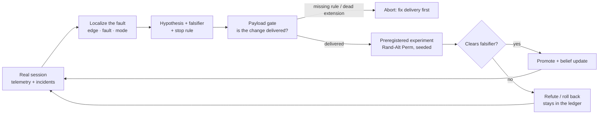

# Akribeia

[](https://github.com/iridyne/akribeia/actions/workflows/validate.yml)


[](LICENSE)

**Zero-dependency wire-payload gate, trace telemetry, and N-of-1 experiment rig for people who tune coding-agent harnesses.**  
*Every harness knob carries its proof.*

> **Meta-Harness positioning (`arXiv:2603.28052`):** Automated outer-loop harness search (e.g., *Meta-Harness*) shows why agents need raw trace filesystems rather than scalar scores. **Akribeia focuses on the other half of post-ChatGPT human–AI co-construction**: deterministic wire-delivery & anti-vacuous gates (`INC-0005` / `INC-0006`), MCP tool-schema context budgets (`tool_budget`), N-of-1 serial-dependence control (`41.6% → 5.6%` false-positive reduction), and human-owned ledger falsification.

## Why this exists

When you customize coding agents ([CC], Codex, OMP, …) with rules, skills, memory, and extensions, the worst failures are silent:

- **Dropped rules** — a rule exists in your config but never reaches the serialized Anthropic/[OI] request payload.
- **Vacuous green checks** — an extension crashes at startup, so a negative assertion ("no error X") passes for the wrong reason (`INC-0006`).
- **Silent cache busting** — a dynamic prefix shifts the system-prompt SHA-256 and kills the Prompt Cache hit rate.
- **Tuning illusions** — before/after comparisons on autocorrelated coding sessions declare effects that are not there (`41.6%` false positives in the AR(1) simulation below).

Akribeia sits **underneath** your agent runtime — pure Python 3.12+ standard library, zero runtime dependencies — and catches these mechanically, in local workflows and in CI.

## What it catches (real run, `exit 1`)

```text
$ python3 scripts/payload_gate.py \
    --contract contracts/example-harness-contract.toml \
    --payload examples/demo-payloads/anthropic_dead_extension.json

Akribeia payload gate: FAIL (provider=anthropic, system_sha256=f415869f0b9f)
  [FAIL] rule-closure (must_contain/system): missing literal 'Never end a turn on raw tool output.' in scope=system
  [FAIL] rule-permission-path (must_contain/system): missing literal 'Use the sanctioned read escalation path instead of eval open().' in scope=system
  [OK] tool-read-present (tool_present/tools): present
  [FAIL] no-legacy-placeholder (must_not_contain/any): blocked vacuous pass: witness 'rule-closure' failed (INC-0006 anti-vacuous guard)
```

Two rules are missing from the serialized payload, and the negative assertion that would have reported `OK` is refused instead — the witness it depends on failed. That is the `INC-0006` defect class: a check that guards a dead component must not pass.

## Quick Start (30 seconds, zero dependencies)

```bash
# 1. Full stdlib test suite (< 2 s)
python3 -m unittest discover -s tests

# 2. Ledger schema, cross-references, secret/path hygiene (fail-closed)
python3 scripts/audit.py --selftest
python3 scripts/audit.py

# 3. Gate a real captured provider payload against a contract
python3 scripts/payload_gate.py --selftest
python3 scripts/payload_gate.py \
  --contract contracts/example-harness-contract.toml \
  --payload examples/demo-payloads/anthropic_good.json \
  --baseline-payload examples/demo-payloads/anthropic_good.json

# 4. The same five tools behind one entry point, with no install
python3 scripts/akribeia.py gate   --contract contracts/example-harness-contract.toml \
                                   --payload examples/demo-payloads/anthropic_good.json
python3 scripts/akribeia.py trace  examples/demo-sessions --markdown
python3 scripts/akribeia.py power  --seed 42 --trials 200 --markdown
python3 scripts/akribeia.py audit && python3 scripts/akribeia.py report --check

# …or as a console script, if you want it on PATH
pipx install . && akribeia --help
```

Nothing above installs anything except the last line. `akribeia audit` and `akribeia report` read the ledgers of the checkout you run them in, so they work from an installed copy too.

## Scope: what Akribeia is, and is not

- **Is** — a deterministic verification, telemetry, and experimental-design layer for the harness you already run. It answers "did the change reach the model, did it beat serial-dependence noise, and what did it cost per token?"
- **Is not** — another agent runtime, a multi-agent orchestrator (that is [Chorus](https://github.com/Chorus-AIDLC/Chorus)'s problem), or a web dashboard. It adds no runtime dependency, no service, and no chat UI.
- **Is not a leaderboard** — every number here comes from one developer's machine and is scoped as such (`docs/method.md` §8). Refuted hypotheses and failed delivery lapses stay in the repository.

---

## Research program: which harness fits which human

The engineering above exists to serve one open question:

> For a fixed model and a fixed person, which harness composition — rules, skills, memory policy, tool interface, context policy, delegation, verification gates — yields the most finished work per token and the fewest repair turns?

This repository is a **research prototype** for that question, not a product. It studies the loop *human ↔ harness ↔ agent* on three axes, and it treats every knob as an intervention that must survive a gate before it counts.

| Axis | What it means | Primary metric (state) |
|---|---|---|
| Effectiveness | Did the task actually finish correctly | `premature_end_rate`, `abort_rate` (measured) |
| Human–agent friction | How often the human has to re-steer, re-explain, or repair | tool error rate (measured); repair turns per completed task (**planned**) |
| Token efficiency | Work produced per prompt token | cache hit rate, tool-output char share (measured); tokens per completed task (**planned**) |

Self-evolution is the loop, not a feature: an incident or a friction signal becomes a hypothesis, the hypothesis becomes a preregistered experiment, the payload gate proves the intervention was delivered at all, a randomization test decides, and the ledger keeps the rollback if it lost. Nothing auto-merges; the human owns acceptance (`D-004`).



The program, the metric definitions, and the phased roadmap live in [`docs/program.md`](docs/program.md). Preregistered designs are in `experiments/`; every claim they test is in `claims/`.

---

## Core capabilities

1. **Provider-Agnostic Wire-Payload Contract Gate (`scripts/payload_gate.py`)** — verifies serialized request payloads across **Anthropic Messages API**, **[OI] Chat / Responses API**, and **OMP**; detects system-prefix SHA-256 drift; enforces **MCP tool-schema budgets** (`tool_budget` caps on total/MCP/per-server tools and schema characters); and **mechanically rejects vacuous negative-only assertions** unless paired with a positive witness (`INC-0006`).
2. **Privacy-Safe Heavy-Coding Trace Telemetry (`scripts/analyze_traces.py`)** — structural context shares, per-tool failure surfaces, prompt-cache hit rates, deterministic bootstrap 95% CIs, and bilingual (ZH/EN + post-abort) repair-turn detection with Cohen's κ calibration gating (`R4`) from local JSONL traces, without ever committing raw prompts or paths.
3. **N-of-1 Autocorrelation & Power Simulator (`scripts/nof1_power.py`)** — quantifies single-developer serial-dependence false-positive inflation and compares `Before/After` vs. `ABAB` vs. `Randomized Alternating Paired Permutation`.
4. **Evidence-Gated Ledger (`scripts/audit.py`, `scripts/report.py`)** — every harness intervention maps to a typed claim (`literature`, `hypothesis`, or `decision`), every hypothesis names a falsifier and stop rule, and secret/path hygiene is enforced fail-closed in CI.

## Empirical Findings & Methodology

**Method.** One harness, one machine, one developer. Each intervention is one variable, preregistered with a metric, baseline, sample, falsifier, and stop rule; reversible interventions use an alternating schedule rather than before/after; the weekly batch lane is the only place an LLM judge may run, and only for labeling (`D-002`). Threats to validity — model drift, selection bias, judge self-preference, Goodharting, survivorship, serial dependence — are enumerated in `docs/method.md` §8 and are not laundered away in the reports.

1. **Multi-Month Heavy-Coding Trace Audit (`995` sessions, `116,129` tool calls, `19.2B` prompt tokens; [`reports/2026-11-24-empirical-trace-study.md`](reports/2026-11-24-empirical-trace-study.md)):**
   - **Tool outputs dominate context:** `70.8%` of all context characters (`60.2%` per-session mean, 95% CI `[58.2%, 62.4%]`) come from tool results (`eval` alone = `57.3%`), while user prompts represent only `2.3%`. Heavy sessions (`>=10` turns, `716/995`, median `43` turns, P99 `1,352` turns) account for `98.5%` of tool calls.
   - **Structured ACI beats raw shell 5–6× (`LIT-003` corroboration):** `bash` fails at `9.43%` (`3,538 / 37,528`) versus structured `read` (`1.89%`) and `grep` (`1.53%`); `edit` fails at `6.67%`.
   - **Missing project root hurts reliability:** ephemeral `--private-tmp--` sessions show `+64%` higher tool error rate (`7.91%` vs. `4.81%`) and higher aborts (`33.2%` vs. `25.1%`).
   - **Confound honesty:** observational digest-vs-cache correlations are documented as session-length confounded rather than laundered as causal proof.
2. **N-of-1 Autocorrelation & Power Simulation (`seed=42`, `1,000` trials; [`reports/2026-11-24-nof1-power-study.md`](reports/2026-11-24-nof1-power-study.md)):**
   - Under realistic single-developer AR(1) serial dependence ($\rho = 0.7$, $N = 40$), naive **Before/After (`AB`)** falsely declares a zero-effect change significant **`41.6%`** of the time (8× nominal $\alpha = 5\%$).
   - **Randomized Alternating Paired Permutation (`Rand-Alt Perm`)** controls false positives at **`5.6%`** while lifting power (`0.5 SD` effect) from `54.2%` to **`78.3%`** (`97.2%` at $N = 80$).
3. **Real Double-Failure Catch (`INC-0005` + `INC-0006`; [`reports/2026-11-23-weekly.md`](reports/2026-11-23-weekly.md)):**
   - Wire-payload probing caught six extensions silently failing at startup (`5/11` mapped rules missing from the live request) **and** caught a vacuous negative assertion reporting `true` precisely because the extension it guarded was dead.
   - Fixed architecturally in `M-020`: `scripts/payload_gate.py` enforces schema-level `requires_witness` pairing and aborts fail-closed on startup errors or prompt-cache prefix drift (`EXP-0017`).

## Repository Map

| Path | Purpose |
|---|---|
| `scripts/akribeia.py` | Unified CLI: `gate`, `trace`, `power`, `audit`, `report` |
| `scripts/payload_gate.py` | Provider-agnostic wire-payload gate (Anthropic/[OI]/OMP), anti-vacuous guard (`INC-0006`), prompt-cache prefix SHA-256 drift detector |
| `scripts/analyze_traces.py` | Privacy-safe JSONL trace telemetry analyzer with deterministic bootstrap 95% CIs |
| `scripts/nof1_power.py` | Monte Carlo N-of-1 AR(1) false-positive & statistical power simulator |
| `scripts/audit.py` | Schema, cross-reference, coverage, and secret/path hygiene validator + `--selftest` |
| `scripts/report.py` | Renders `reports/ledger.md` deterministically from TOML ledgers |
| `contracts/` & `examples/` | Declarative wire-payload contract + runnable Anthropic/[OI]/trace fixtures (including a failing dead-extension case) |
| `docs/program.md` | Research program: the harness-fit question, metric definitions, self-evolution loop, phased roadmap with status |
| `docs/{method,taxonomy,prior-art,theory,playground}.md` | Evidence-gated method, failure taxonomy, prior-art review, theory, playground notes |
| `tests/test_akribeia.py` | Zero-dependency `unittest` suite covering all modules and failure modes |
| `claims/`, `mapping/`, `experiments/`, `incidents/`, `ledger/` | Machine-checked TOML/JSONL research ledgers |
| `adapters/omp/` | OMP prompt-assertion probe and session collector |
| `reports/` | Generated ledger + empirical trace study + N-of-1 power study + weekly incident reports |

## Origin: etymology and prior art

*Akribeia* (Ancient Greek ἀκρίβεια: *exactness, rigorous verification*) is the sister project to [Aletheia](https://github.com/iridyne/aletheia), and was formerly prototyped as Proof-Carrying Harness (PCH). The name is a claim about the standard, not about the ancestry: agent quality is `model × harness`, and harness claims should be checkable.

**Core literature anchors:**

- Macedo (2026) *What makes a harness a harness* (`arXiv:2606.10106`) — necessary & sufficient conditions (`LIT-001`)
- Lee, Khattab, Finn et al. (2026) *Meta-Harness: End-to-End Optimization of Model Harnesses* (`arXiv:2603.28052`) — uncompressed filesystem trace access for outer-loop search (`LIT-017`)
- Gu (2026) *From Model Scaling to System Scaling: Scaling the Harness in Agentic AI* (`arXiv:2605.26112`) — six-factor framing & stale memory (`LIT-002`, `LIT-011`, `LIT-012`)
- Raj et al. (2026) *Model or Harness? An Interaction-Centric Taxonomy for Localizing Agent Failures* (`arXiv:2607.28802`) — edge/fault localization (`LIT-007`)
- Pan et al. (2026) *Natural-Language Agent Harnesses* (`arXiv:2603.25723`) — ablatable rule modules (`LIT-009`)
- Ren et al. (2026) *Self-Improvements in Modern Agentic Systems* (`arXiv:2607.13104`) — gated scaffold update operator (`LIT-010`)
- Cemri et al. (2025) *Why Do Multi-Agent LLM Systems Fail?* (`arXiv:2503.13657`), Yang et al. (2024) *SWE-agent*, Xia et al. (2024) *Agentless*, METR (2024), Liu et al. (2024) *Lost in the Middle*, Khattab et al. (2023) *DSPy*, Horvitz (1999) *Mixed-Initiative UI*.

Fourteen prior-art frameworks, and what was adopted or rejected from each, are reviewed in `docs/prior-art.md`.

## License

MIT. See `LICENSE`.
