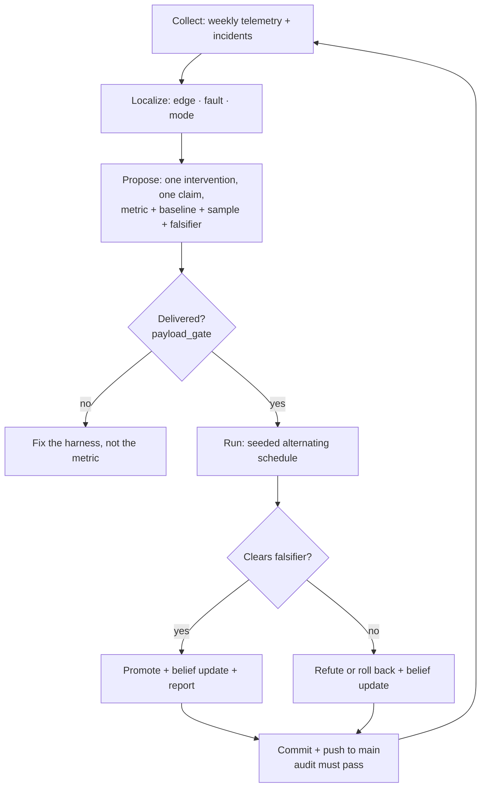

# Program: human × harness × agent co-optimization

This file states what the repository is trying to find out, how a result would be recognized, and what is next. It is a program, not a result: anything here that is not backed by a ledger entry is a plan.

## 1. The question

> For a fixed model and a fixed person, which harness composition — rules, skills, memory policy, tool interface, context policy, delegation, verification gates — yields the most finished work per token and the fewest repair turns?

The unit of analysis is one developer working with one agent runtime over weeks. Between-subject statistics do not apply; the relevant designs are single-case experimental designs (`docs/prior-art.md` §3), and the relevant noise is serial dependence (`H-014`).

Two consequences shape everything below:

- A harness change is only measurable if it **reaches the wire payload**. Delivery is therefore a precondition, not a metric (`INC-0005`, `M-019`, `M-020`).
- A harness change is only credible if it **beats autocorrelation noise**. Before/after on daily metrics is the weakest design available and is labeled quasi-experimental (`D-008`).

## 2. Three axes, and what is actually measured

| Axis | Question | Metric | Computed by | State |
|---|---|---|---|---|
| Effectiveness | Did the turn end with the task done? | `premature_end_rate`, `abort_rate` | `analyze_traces.py` | measured |
| Human–agent friction | How often does the human have to re-steer? | tool error rate (pooled + per tool) | `analyze_traces.py` | measured |
| Human–agent friction | …per unit of finished work | repair turns per completed session | — | **planned** |
| Token efficiency | Work produced per prompt token | prompt-cache hit rate, tool-output char share | `analyze_traces.py` | measured |
| Token efficiency | …per unit of finished work | prompt tokens per completed session | — | **planned** |
| Verification cost | What does the checking itself cost? | gate wall-clock, audit wall-clock, CI minutes | — | **planned** |

Definitions that matter when reading the numbers:

- **Repair turn** — a user turn whose content is a correction of the previous assistant turn (re-scope, contradiction, "no, I said"). Requires a labeled event table; a text heuristic is not enough to promote a claim (`D-002`, judge calibration rule in `docs/method.md` §3).
- **Completed session** — a session whose final assistant turn contains non-empty text and whose last tool result is not an error. This is a proxy; it does not prove the task was correct.
- **Tokens per completed session** — pooled prompt tokens divided by completed sessions, in a fixed task-mix window. Task mix must be reported alongside; a metric that improves by dropping hard tasks is not an improvement.

The analyzer already produces the raw denominators. The missing piece is the labeled event table that separates "the human had to intervene" from "the human chose to continue".

## 3. What counts as a finding

Follow `docs/method.md`. In short:

1. One variable per experiment; bundles are exploratory and cannot promote (`D-008`).
2. Reversible intervention → ABAB or randomized alternating schedule with a preregistered seed; irreversible → before/after labeled quasi-experimental.
3. Promotion needs the preregistered sample, the preregistered metric, and a result that clears the falsifier. A single session never promotes.
4. A model upgrade invalidates local evidence until the experiment is re-run (`docs/method.md` §8).
5. Refuted hypotheses, rollbacks, and failed delivery lapses stay in the ledger. Deleting them is out of scope.

## 4. Self-evolution, with the brakes that make it honest

The loop is: observe → localize → hypothesize → **prove delivery** → experiment → promote or roll back → record. What makes it self-evolving rather than self-flattering is that every step has a deterministic artifact and a stopping condition.

Guardrails, in order of importance:

- **No LLM judge in the interactive path** (`D-002`). Judges label and draft; deterministic metrics promote.
- **The audit is the review gate** (`D-014`). One maintainer, so changes push straight to `main`; a failing `audit.py`, an unmapped change, or a force-push blocks the push. The ledger keeps the rollback either way.
- **Delivery before measurement** (`H-013`, `EXP-0015`). A gate failure aborts the cycle instead of producing numbers about a harness that was not running.
- **Rollback is a normal outcome**, recorded as an experiment result or incident (`docs/method.md` §9).
- **Cost sits next to every result.** A change that improves a metric at a much higher token cost is not automatically an improvement (`docs/prior-art.md` §5).

## 5. Roadmap and status

Status is either **done** (verifiable in this repository now), **in progress**, or **planned**. Each item names its acceptance check so "done" cannot drift.

### Engineering lane — make it usable by someone else in one minute

| # | Item | Acceptance check | Status |
|---|---|---|---|
| E1 | Unified CLI (`akribeia gate/trace/power/audit/report`) with zero runtime dependencies | `python3 scripts/akribeia.py --help` lists five subcommands; `tests/` covers dispatch | done |
| E2 | `pyproject.toml` with a console script and no runtime dependencies | `pip install .` then `akribeia --help`; `dependencies = []` | done |
| E3 | A failing fixture next to every passing one, runnable by hand | `examples/demo-payloads/anthropic_dead_extension.json` exits 1 with a blocked vacuous pass | done |
| E4 | `[CC]` and Codex read-only adapters: parse their local JSONL logs into the analyzer's schema | adapter fixture parses a real-format log and yields non-zero sessions | planned |
| E5 | Local read-only capture of the real wire payload for `[CC]` / Codex (stdlib `http.server` proxy) | a captured payload passes `payload_gate.py` on a good config and fails on a missing rule | planned |
| E6 | Built-in detector pack: cache-prefix drift, vacuous negative assertion, **MCP tool-schema budget gate**, skill lazy-load check | each detector has one fixture that fails and one that passes | planned |

E6 is the one with the clearest everyday payoff: an MCP server that ships forty tool schemas eats context before the first token of work, and nothing currently measures that.

### Research lane — build the part that cannot be copied

| # | Item | Acceptance check | Status |
|---|---|---|---|
| R1 | Randomized harness switcher: seeded alternating A/B of one toggle, sessions auto-labeled, paired permutation test at the end, report written to `experiments/` | a dry run over synthetic sessions reproduces the `nof1_power.py` false-positive/power figures | planned |
| R2 | Cross-agent, cross-model desensitized comparison reports (same metric set: tool error rate, cache hit rate, context-growth slope, abort rate) | one report per comparison, each with a rerun script and synthetic fixture | planned |
| R3 | Continuous falsification register: every popular configuration tested here that showed no gain, kept with its design and result | each entry has an experiment ID and a falsifier | in progress (the ledger already keeps refutations; the register is the reader-facing view) |
| R4 | Friction metric validation: does a text-heuristic repair-turn count agree with human labels on ≥20 incidents? | agreement statistic reported; below threshold the metric stays uncalibrated | planned |
| R5 | Token-efficiency frontier: plot harness variants on (tokens per completed session, effectiveness) instead of one score | frontier reported for at least three variants | planned |

## 6. Deliberately deferred

- **CI wiring.** The gate is designed to run as a one-line CI step, but the repository does not ship a workflow for it yet. The tool must first be worth gating on: until the detector pack (E6) covers the failures this project actually hits, a CI job would only re-run the same fixtures the test suite already covers.
- **Installable packaging polish.** `pyproject.toml` exists so the CLI can be installed, but publishing to PyPI is not planned until the adapter set (E4) is usable.

## 7. Non-goals

- No agent runtime, no orchestration layer, no chat UI, no web dashboard.
- No hosted service, no account, no telemetry upload. Everything runs locally.
- No leaderboard across users; a local effect is local.
- No new runtime dependency. A tool that needs `pip install -r requirements.txt` before it can check a payload has already lost the argument.

## 8. How to contribute to the program

Open an incident with a real trace excerpt, or a hypothesis with a metric, baseline, sample, and falsifier. Bundles and "it felt better" reports are welcome as exploratory notes but cannot promote a claim. See `CONTRIBUTING.md` and the issue templates.
